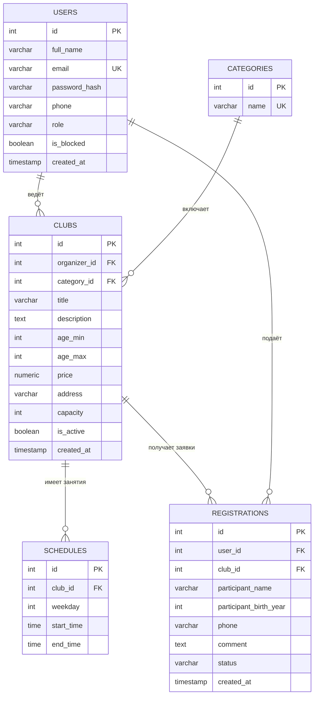
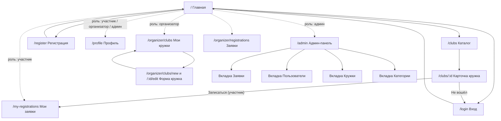

# Архитектура: веб-каталог кружков и секций с регистрацией участников

**Проект:** «Разработка веб-каталога кружков и секций с регистрацией участников»

**Описание:** сайт собирает кружки и секции в одном каталоге. Родители ищут занятия по возрасту ребёнка, категории и цене и записываются онлайн. Организаторы кружков публикуют занятия и принимают заявки. Администратор следит за порядком. Проблема, которую решаем: информация о кружках разбросана по соцсетям и объявлениям, запись идёт по телефону, организаторы теряют заявки.

**Стек:** React (Vite) + Node.js + Express + PostgreSQL.

> ⚠️ **Про Prisma.** В исходном требовании к стеку указан Prisma (инструмент, который сам пишет SQL-запросы по описанию таблиц). В реализованном проекте Prisma **не используется**: запросы к PostgreSQL пишутся вручную на SQL через библиотеку `pg`. Это осознанное упрощение (SQL виден и понятен «как есть», меньше «магии»). Если преподаватель требует Prisma, схему из раздела 5 можно перенести в файл `schema.prisma` без изменения таблиц. См. вопрос 1 в конце документа.

---

## 0. Уточняющие вопросы и ответы

Вместо отдельной переписки я взял ответы из готового проекта. Если что-то неверно, поправь, и я перепишу нужные разделы.

| № | Вопрос | Ответ |
| --- | --- | --- |
| 1 | Кто пользуется сайтом? | Родители и взрослые ученики (участники), организаторы кружков, администратор площадки, гости без аккаунта |
| 2 | Какую проблему решаем? | Разрозненная информация о кружках, ручная запись, потерянные заявки, непонятно, есть ли свободные места |
| 3 | Нужна ли онлайн-оплата? | Нет. Цена только показывается в карточке |
| 4 | Есть ли у родителя профили детей? | Нет. Данные ребёнка (имя, год рождения) вводятся в каждой заявке |
| 5 | Кто подтверждает запись? | Организатор этого кружка (и администратор) |
| 6 | Нужны ли уведомления? | Да: письмо организатору о новой записи, письма родителю о статусе заявки; кнопка WhatsApp для связи |
| 7 | Где будет работать сайт? | Локально на компьютере (учебный проект), без размещения в интернете |

---

## 1. Пользователи и роли

| Роль | Кто это | Что может |
| --- | --- | --- |
| **Гость** | Любой посетитель без входа | Смотреть каталог и карточки кружков, искать и фильтровать, регистрироваться, входить |
| **Участник** | Родитель или взрослый ученик | Всё, что гость; подавать заявки на запись, видеть и отменять свои заявки, менять профиль |
| **Организатор** | Руководитель кружка | Создавать, менять и скрывать **свои** кружки, задавать расписание, видеть заявки на свои кружки, подтверждать и отклонять их, получать письма о новых записях |
| **Администратор** | Хозяин площадки | Видеть все заявки и обрабатывать их, блокировать пользователей, управлять категориями, скрывать любые кружки |

**Почему так:** роль хранится в таблице `users` в одном поле `role`. Если раздать права «на глаз» по страницам, любой пользователь сможет открыть чужой раздел, подставив адрес вручную. Роли проверяются на сервере (см. раздел 4).

**Почему организатор и участник разные роли:** организатор принимает заявки, участник подаёт. Если смешать, один человек сможет подтверждать собственные заявки.

---

## 2. MVP

### Что входит (10 функций)

1. Регистрация и вход (роли: участник, организатор), выход.
2. Каталог кружков с карточками (название, категория, возраст, цена, свободные места).
3. Поиск по названию и фильтры: категория, возраст, бесплатные.
4. Страница кружка: описание, организатор, расписание, адрес, контакты, форма записи.
5. Запись в кружок: имя ребёнка, год рождения, телефон, комментарий.
6. Личный кабинет участника: список заявок со статусами, отмена.
7. Кабинет организатора: создать, изменить, скрыть кружок, задать расписание.
8. Заявки организатора: список, кнопки «Подтвердить» и «Отклонить».
9. Контроль мест: нельзя записаться при отсутствии мест и подать повторную заявку на того же ребёнка.
10. Админ-панель: категории, блокировка пользователей, скрытие кружков.

### Добавлено сверх MVP (уже реализовано)

- Вкладка «Заявки» в админ-панели: админ видит и обрабатывает все заявки.
- Письма: организатору о новой записи, родителю о статусе заявки.
- Кнопка WhatsApp (плавающая, в карточке кружка и в подвале).

### Что НЕ входит в первую версию и почему

| Что | Почему отложено |
| --- | --- |
| Онлайн-оплата | Требует договора с платёжной системой и юридических вопросов; для каталога не критична |
| Отзывы и оценки | Нужна модерация, иначе появятся спам и фейки |
| Фотографии кружков | Нужно хранилище файлов; текстового описания достаточно |
| Карта | Нужны координаты и внешний сервис карт |
| Профили детей | Усложняют форму; в MVP достаточно ввести данные в заявке |
| Мобильное приложение | Сайт уже адаптируется под телефон |

**Почему так:** MVP, который можно закончить и показать, лучше большого проекта, который не запускается. Всё, что лежит в «не входит», добавляется без переделки основы (см. раздел 10).

---

## 3. Пользовательские истории

Формат: «Как [роль], я хочу [действие], чтобы [цель]». Колонка «MVP»: ✅ входит в MVP, ➕ добавлено после MVP (уже реализовано).

| № | История | MVP | Эндпоинты |
| --- | --- | --- | --- |
| US-1 | Как **гость**, я хочу смотреть каталог кружков, чтобы понять, что есть в городе | ✅ | GET /api/clubs |
| US-2 | Как **гость**, я хочу искать и фильтровать по возрасту, категории и цене, чтобы быстро найти подходящий кружок | ✅ | GET /api/clubs, GET /api/categories |
| US-3 | Как **гость**, я хочу открыть карточку кружка с расписанием и числом свободных мест, чтобы решить, записываться ли (и написать организатору в WhatsApp) | ✅ | GET /api/clubs/:id |
| US-4 | Как **гость**, я хочу зарегистрироваться как участник или организатор, чтобы пользоваться кабинетом | ✅ | POST /api/auth/register |
| US-5 | Как **пользователь**, я хочу входить на сайт и менять свой профиль, чтобы работать под своим аккаунтом | ✅ | POST /api/auth/login, GET /api/auth/me, PUT /api/profile |
| US-6 | Как **участник**, я хочу записать ребёнка в кружок, чтобы занять место | ✅ | POST /api/registrations |
| US-7 | Как **участник**, я хочу видеть свои заявки и их статусы, чтобы знать, ответили ли мне | ✅ | GET /api/registrations/my |
| US-8 | Как **участник**, я хочу отменить заявку, чтобы освободить место, если планы изменились | ✅ | PATCH /api/registrations/:id/cancel |
| US-9 | Как **организатор**, я хочу создать кружок с расписанием, вместимостью и ценой, чтобы люди могли найти меня | ✅ | POST /api/organizer/clubs, GET /api/categories |
| US-10 | Как **организатор**, я хочу изменить или скрыть свой кружок, чтобы информация была актуальной | ✅ | GET, PUT, DELETE /api/organizer/clubs/:id, GET /api/organizer/clubs |
| US-11 | Как **организатор**, я хочу видеть заявки на мои кружки и подтверждать или отклонять их, чтобы формировать группы | ✅ | GET /api/organizer/registrations, PATCH /api/organizer/registrations/:id |
| US-12 | Как **администратор**, я хочу блокировать пользователей, управлять категориями и скрывать кружки, чтобы поддерживать порядок | ✅ | /api/admin/users…, /api/admin/categories…, /api/admin/clubs… |
| US-13 | Как **администратор**, я хочу видеть все заявки сайта и обрабатывать их, чтобы контролировать работу площадки | ➕ | GET, PATCH /api/admin/registrations |
| US-14 | Как **организатор**, я хочу получать письмо, когда в мой кружок записываются, чтобы не проверять сайт вручную | ➕ | (внутренняя отправка при POST /api/registrations) |
| US-15 | Как **родитель**, я хочу получить письмо о том, что заявку приняли или подтвердили, чтобы не гадать | ➕ | (внутренняя отправка при PATCH …/registrations/:id) |

---

## 4. Бизнес-правила

Правила, которые **сервер проверяет всегда**.

| № | Правило | Почему нельзя проверять только в браузере |
| --- | --- | --- |
| BR-1 | Пароль хранится только в виде хеша (bcrypt), в открытом виде нигде | Браузером управляет пользователь; любые «секреты» в нём видны. Хешируется только на сервере |
| BR-2 | Роль `admin` нельзя получить через форму регистрации: любое значение, кроме `organizer`, превращается в `participant` | Злоумышленник отправит запрос в обход формы с ролью admin |
| BR-3 | Заблокированный пользователь не может войти, а старый токен перестаёт работать (сервер при каждом запросе читает пользователя из базы) | Токен уже лежит в браузере; только сервер может его «отозвать» |
| BR-4 | Организатор меняет только **свои** кружки и обрабатывает заявки только на свои кружки (условие `organizer_id = мой id` внутри SQL) | Подменить id в запросе можно за секунду; сайт не отличит свой кружок от чужого |
| BR-5 | Участник видит и отменяет только **свои** заявки | То же: чужие id легко подставить |
| BR-6 | Записываться могут только участники; организатор и админ записаться не могут | Кнопку можно «вернуть» в браузере |
| BR-7 | Свободных мест = `capacity` − число заявок в статусах `pending` и `confirmed`; при отсутствии мест запись запрещена | Два человека могут нажать одновременно; считать место можно только в одной точке, на сервере, внутри транзакции |
| BR-8 | Нельзя подать вторую активную заявку на того же ребёнка в тот же кружок (уникальный индекс в базе); после отмены можно снова | Двойной клик или повторный запрос обойдут проверку в браузере |
| BR-9 | Подтвердить или отклонить можно только заявку со статусом `pending` | Иначе можно «воскресить» отменённую заявку |
| BR-10 | Нельзя записаться в скрытый (неактивный) или несуществующий кружок | Страницу кружка можно открыть по старой ссылке |
| BR-11 | Возраст `age_max ≥ age_min`, цена ≥ 0, мест > 0, конец занятия позже начала, год рождения в разумных пределах | Форму можно отправить напрямую, минуя проверки браузера |
| BR-12 | Категорию, в которой есть кружки, удалить нельзя | Иначе кружки «повиснут» без категории |
| BR-13 | Администратор не может заблокировать себя и других администраторов | Иначе можно случайно лишить сайт управления |

**Почему так:** браузер — это территория пользователя. Всё, что он присылает, нужно считать ненадёжным. Проверки в браузере нужны только для удобства (быстро показать ошибку), настоящая защита всегда на сервере.

---

## 5. База данных

### Таблицы

**users**

| Поле | Тип | Описание |
| --- | --- | --- |
| id | SERIAL, PK | Идентификатор |
| full_name | VARCHAR(100) | ФИО |
| email | VARCHAR(150), UNIQUE | Логин |
| password_hash | VARCHAR(255) | Хеш пароля |
| phone | VARCHAR(20), NULL | Телефон |
| role | VARCHAR(20), CHECK | `participant`, `organizer`, `admin` |
| is_blocked | BOOLEAN | Заблокирован ли |
| created_at | TIMESTAMP | Дата регистрации |

**categories**

| Поле | Тип | Описание |
| --- | --- | --- |
| id | SERIAL, PK | |
| name | VARCHAR(80), UNIQUE | Название |

**clubs**

| Поле | Тип | Описание |
| --- | --- | --- |
| id | SERIAL, PK | |
| organizer_id | INT, FK → users.id (ON DELETE CASCADE) | Владелец |
| category_id | INT, FK → categories.id | Категория |
| title | VARCHAR(150) | Название |
| description | TEXT | Описание |
| age_min, age_max | INT, CHECK | Возрастные границы |
| price | NUMERIC(10,2), CHECK ≥ 0 | Цена в месяц, 0 = бесплатно |
| address | VARCHAR(255) | Адрес |
| capacity | INT, CHECK > 0 | Всего мест |
| is_active | BOOLEAN | Виден ли в каталоге |
| created_at | TIMESTAMP | |

**schedules**

| Поле | Тип | Описание |
| --- | --- | --- |
| id | SERIAL, PK | |
| club_id | INT, FK → clubs.id (ON DELETE CASCADE) | Кружок |
| weekday | INT, CHECK 1–7 | День недели |
| start_time, end_time | TIME, CHECK конец > начала | Время занятия |

**registrations**

| Поле | Тип | Описание |
| --- | --- | --- |
| id | SERIAL, PK | |
| user_id | INT, FK → users.id (ON DELETE CASCADE) | Кто подал |
| club_id | INT, FK → clubs.id (ON DELETE CASCADE) | Куда |
| participant_name | VARCHAR(100) | Имя ребёнка |
| participant_birth_year | INT | Год рождения |
| phone | VARCHAR(20) | Телефон для связи |
| comment | TEXT, NULL | Комментарий |
| status | VARCHAR(20), CHECK | `pending`, `confirmed`, `rejected`, `cancelled` |
| created_at | TIMESTAMP | |

Дополнительно: **частичный уникальный индекс** по `(club_id, user_id, participant_name)` для заявок со статусом `pending` или `confirmed`.

### Связи

| Связь | Тип | Смысл |
| --- | --- | --- |
| users → clubs | один-ко-многим | У организатора много кружков |
| categories → clubs | один-ко-многим | В категории много кружков |
| clubs → schedules | один-ко-многим | У кружка несколько занятий в неделю |
| clubs → registrations | один-ко-многим | На кружок много заявок |
| users → registrations | один-ко-многим | Участник подаёт много заявок |

Связей «многие-ко-многим» нет. Фактически `registrations` связывает users и clubs, но это отдельная сущность со своими полями (статус, имя ребёнка), поэтому она оформлена как полноценная таблица.

### ER-диаграмма (Mermaid)



### Проверка: дублирование и расширяемость

- **Дублирование.** Категории и расписание вынесены в свои таблицы, а не повторяются в строках кружков. Свободные места **не хранятся** отдельным числом, а считаются из заявок: так число не может «разъехаться» с реальностью. Телефон есть и в `users`, и в `registrations`, но это разные вещи: телефон аккаунта и телефон, по которому звонить именно по этой заявке (может быть другой).
- **Слабое место.** Имя и год рождения ребёнка хранятся прямо в заявке. Если родитель записывает того же ребёнка в три кружка, данные вводятся три раза, а «профиля ребёнка» в базе нет. Для MVP это нормально. Как добавить профили детей без поломок, см. раздел 10.
- **Новые функции.** Отзывы, избранное, фото добавляются **новыми таблицами** со ссылками на `users` и `clubs`; существующие таблицы не меняются.

**Почему так:** ограничения (`CHECK`, `UNIQUE`, внешние ключи) стоят в самой базе, а не только в коде. Даже если в программе появится ошибка, база не позволит записать отрицательную цену или заявку в несуществующий кружок.

---

## 6. API

Базовый адрес: `/api`. Формат: JSON. Защищённые маршруты требуют заголовок `Authorization: Bearer <токен>`. Ошибки приходят в виде `{ "error": "текст" }` с кодом 400, 401, 403, 404 или 409.

| Метод | Адрес | Что делает | Доступ | Пример: запрос → ответ | История |
| --- | --- | --- | --- | --- | --- |
| POST | /api/auth/register | Регистрация | все | `{full_name, email, password, role}` → `201 {token, user}` | US-4 |
| POST | /api/auth/login | Вход | все | `{email, password}` → `200 {token, user}` | US-5 |
| GET | /api/auth/me | Данные текущего пользователя | вошедшие | — → `{user}` | US-5 |
| PUT | /api/profile | Изменить профиль | вошедшие | `{full_name, phone}` → `{user}` | US-5 |
| GET | /api/categories | Список категорий | все | — → `[{id, name}]` | US-2, US-9 |
| GET | /api/clubs | Каталог (фильтры `search`, `category`, `age`, `free`) | все | `?age=8&free=true` → `[{id, title, price, free_seats, …}]` | US-1, US-2 |
| GET | /api/clubs/:id | Карточка кружка | все | — → `{…, schedule: [{weekday, start_time, end_time}]}` | US-3 |
| POST | /api/registrations | Подать заявку | участник | `{club_id, participant_name, participant_birth_year, phone, comment}` → `201 {id, status:"pending"}` | US-6, US-14 |
| GET | /api/registrations/my | Мои заявки | участник | — → `[{id, club_title, status, …}]` | US-7 |
| PATCH | /api/registrations/:id/cancel | Отменить свою заявку | участник (владелец) | — → `{id, status:"cancelled"}` | US-8 |
| GET | /api/organizer/clubs | Мои кружки | организатор | — → `[{id, title, free_seats, is_active, …}]` | US-10 |
| GET | /api/organizer/clubs/:id | Мой кружок для редактирования | организатор (владелец) | — → `{…, schedule}` | US-10 |
| POST | /api/organizer/clubs | Создать кружок | организатор | `{title, category_id, age_min, age_max, price, capacity, schedule:[…]}` → `201 {id}` | US-9 |
| PUT | /api/organizer/clubs/:id | Изменить кружок и расписание | организатор (владелец) | те же поля → `{ok:true}` | US-10 |
| DELETE | /api/organizer/clubs/:id | Скрыть кружок | организатор (владелец) | — → `{ok:true}` | US-10 |
| GET | /api/organizer/registrations | Заявки на мои кружки | организатор | — → `[{participant_name, parent_name, phone, status, …}]` | US-11 |
| PATCH | /api/organizer/registrations/:id | Подтвердить или отклонить | организатор (владелец) | `{status:"confirmed"}` → `{id, status}` | US-11, US-15 |
| GET | /api/admin/users | Все пользователи | админ | — → `[{id, email, role, is_blocked}]` | US-12 |
| PATCH | /api/admin/users/:id/block | Блокировать / разблокировать | админ | — → `{id, is_blocked}` | US-12 |
| GET | /api/admin/clubs | Все кружки | админ | — → `[{id, title, is_active, …}]` | US-12 |
| PATCH | /api/admin/clubs/:id/hide | Скрыть / показать кружок | админ | — → `{id, is_active}` | US-12 |
| GET | /api/admin/registrations | Все заявки | админ | — → `[{participant_name, parent_name, club_title, …}]` | US-13 |
| PATCH | /api/admin/registrations/:id | Подтвердить или отклонить | админ | `{status:"rejected"}` → `{id, status}` | US-13, US-15 |
| POST | /api/admin/categories | Добавить категорию | админ | `{name}` → `201 {id, name}` | US-12 |
| PUT | /api/admin/categories/:id | Переименовать категорию | админ | `{name}` → `{id, name}` | US-12 |
| DELETE | /api/admin/categories/:id | Удалить категорию (если пуста) | админ | — → `{ok:true}` или `409` | US-12 |

### Пример подробнее: запись в кружок

Запрос:
```json
POST /api/registrations
Authorization: Bearer eyJhbGciOi...
{ "club_id": 1, "participant_name": "Дима", "participant_birth_year": 2012,
  "phone": "+77001234567", "comment": "Первый раз" }
```
Успех: `201 { "id": 5, "status": "pending" }`.
Ошибки: `409 { "error": "Свободных мест нет" }`, `409 { "error": "Вы уже подали заявку для этого участника" }`, `403 { "error": "Недостаточно прав" }` (для организатора).

**Почему так:** адреса и методы устроены по единому правилу (REST): GET читает, POST создаёт, PUT и PATCH меняют, DELETE удаляет. Тогда любой разработчик угадает адрес, не читая код. Адреса с префиксами `/organizer` и `/admin` позволяют одной строкой защитить весь раздел.

---

## 7. Страницы

### Список страниц по ролям

| Роль | Страницы |
| --- | --- |
| Гость | `/` главная, `/clubs` каталог, `/clubs/:id` карточка, `/login`, `/register`, `*` (404) |
| Участник | всё то же + `/my-registrations`, `/profile` |
| Организатор | всё то же (кроме «Мои заявки» участника) + `/organizer/clubs`, `/organizer/clubs/new`, `/organizer/clubs/:id/edit`, `/organizer/registrations`, `/profile` |
| Администратор | `/admin` (вкладки: заявки, пользователи, кружки, категории), `/profile`, каталог |

### Карта страниц (Mermaid)



Сплошные стрелки: переходы по ссылкам и кнопкам. Пунктирные: пункты меню, которые появляются только для своей роли.

**Почему так:** страница, закрытая от «не своей» роли, перенаправляет пользователя на вход или на главную (компонент `Protected`). Но это только удобство: настоящую защиту даёт сервер (раздел 4).

---

## 8. Структура папок проекта

```
kruzhki-catalog/
├── docs/                      # документация: ТЗ, конкуренты, эта архитектура
├── client/                    # сайт (React)
│   ├── src/
│   │   ├── pages/             # страницы
│   │   ├── components/        # повторно используемые элементы (меню, карточка, кнопка WhatsApp)
│   │   ├── App.jsx            # список маршрутов и защита страниц
│   │   ├── AuthContext.jsx    # кто сейчас вошёл
│   │   ├── api.js             # единая функция запросов к серверу
│   │   └── config.js          # контакты (WhatsApp, почта)
│   └── .env                   # номер WhatsApp (не секрет)
└── server/                    # API (Express)
    ├── src/
    │   ├── index.js           # запуск, подключение маршрутов, обработка ошибок
    │   ├── routes/            # маршруты и обработчики запросов
    │   ├── middleware/        # проверка токена и роли
    │   ├── mailer.js          # отправка писем
    │   └── db/                # подключение к PostgreSQL, схема, начальные данные
    ├── test/                  # автоматическая проверка API
    └── .env                   # секреты: база, JWT, почта
```

### Слои сервера

Шаблон предлагает цепочку **routes → controllers → services → database**. Вот что она значит и как это сделано в проекте:

| Слой | За что отвечает (одной строкой) | В проекте |
| --- | --- | --- |
| routes | Принимает запрос по адресу и передаёт дальше | Файлы в `routes/` |
| controllers | Разбирает запрос, проверяет данные и формирует ответ | **Объединён с routes**: обработчики лежат прямо в файлах `routes/*.js` |
| services | Бизнес-логика (правила, расчёты), не зависящая от HTTP | Выделена только отправка почты (`mailer.js`); остальное внутри обработчиков |
| database | Работа с таблицами | SQL-запросы через `pg` внутри обработчиков; подключение в `db/pool.js` |

**Честно:** в проекте 3 слоя вместо 4, потому что проект небольшой. Когда кода станет больше, обработчики нужно разделить на `controllers/` и `services/` (например, `registrationService.createRegistration`). Тогда правила вроде «места закончились» будут лежать в одном месте и их можно тестировать отдельно от HTTP.

**Почему так:** разделение по слоям нужно, чтобы менять одно и не ломать другое. Захотите заменить Express на другой фреймворк, и переписать придётся только routes, а не правила записи.

---

## 9. Безопасность

| Что | Как сделано | Что будет, если иначе |
| --- | --- | --- |
| Пароли | Хранится только хеш bcrypt (необратимый «отпечаток» с «солью») | При утечке базы все пароли видны |
| Вход | После входа сервер выдаёт токен JWT (подписанный «пропуск», действует 7 дней). Браузер хранит его в `localStorage` и шлёт в заголовке `Authorization` | Без токена сервер не узнает, кто делает запрос |
| Проверка при каждом запросе | `middleware/auth.js` проверяет подпись, читает пользователя из базы и проверяет блокировку; `requireRole` проверяет роль | Заблокированный пользователь продолжил бы работать до конца срока токена |
| Права на данные | Условие в SQL: `organizer_id = мой id`, `user_id = мой id` | Любой подставил бы чужой id и изменил чужие данные |
| SQL-инъекции (вредный текст в форме превращается в команду базе) | Все запросы с параметрами `$1, $2…` | Через поле формы можно было бы удалить таблицы |
| XSS (вредный скрипт в тексте, например в названии кружка) | React экранирует любой выводимый текст; в письмах специальные символы экранируются | Скрипт запустился бы у других пользователей |
| Роль админа | Создаётся только скриптом `seed`; через регистрацию получить нельзя | Любой стал бы админом |

### Что хранится в .env

**`server/.env`** (секрет, в репозиторий не попадает, закрыт в `.gitignore`):

| Переменная | Назначение |
| --- | --- |
| `DATABASE_URL` | Адрес и пароль базы данных |
| `JWT_SECRET` | Секретный ключ для подписи токенов (если утечёт, токены можно подделать) |
| `MAIL_USER`, `MAIL_PASS` | Аккаунт Gmail и пароль приложения для отправки писем |
| `NOTIFY_EMAIL` | Запасной адрес для писем организатору (демо-аккаунты) |
| `CLIENT_URL` | Адрес сайта для ссылок в письмах |
| `MAIL_MODE` | `console` — режим проверки без реальной отправки |

**`client/.env`** (ВНИМАНИЕ: значения с `VITE_` попадают в браузер и видны всем, секретов здесь быть не должно): `VITE_WHATSAPP_PHONE`, `VITE_CONTACT_EMAIL`.

### Известные слабые места (честно)

- Токен лежит в `localStorage`, а для «боевого» сайта лучше `HttpOnly`-cookie (до неё скрипт на странице не доберётся).
- CORS (разрешение чужим сайтам обращаться к API) открыт для всех: для учебного проекта допустимо, для публикации нужно ограничить адресом своего сайта.
- Нет ограничения числа попыток входа (защита от подбора пароля) и подтверждения почты.
- Сайт работает по HTTP, для публикации нужен HTTPS.

**Почему так:** безопасность строится в несколько слоёв: если один подведёт (например, токен украли), другие (проверка блокировки, права на данные) ограничат ущерб.

---

## 10. Расширение

### Функция 1. Отзывы и оценки кружков

- **Что добавить:** таблица `reviews (id, user_id, club_id, rating 1–5, text, created_at)` с уникальностью «один отзыв от пользователя на кружок»; эндпоинты `GET /api/clubs/:id/reviews`, `POST /api/clubs/:id/reviews`; блок отзывов на странице кружка; средний рейтинг в каталоге.
- **Что менять в старом:** почти ничего: в запрос каталога добавляется подсчёт среднего рейтинга. **Переписывать не придётся.**
- **Правило:** отзыв может оставить только участник с подтверждённой заявкой в этот кружок (проверяет сервер).

### Функция 2. Профили детей

- **Что добавить:** таблица `children (id, user_id, full_name, birth_year)`; эндпоинты для списка, добавления и удаления детей; в форме записи выбор ребёнка из списка.
- **Что менять в старом:** в `registrations` вместо `participant_name` и `participant_birth_year` ссылка `child_id`. Это **самое болезненное изменение**: затронет схему, запись, письма и все таблицы заявок.
- **Как спроектировать сейчас, чтобы не переписывать:** при внедрении сначала добавить `child_id` как **необязательное** поле (NULL), оставить старые поля, перенести существующие заявки скриптом (создать детей из старых имён), и только потом убрать старые поля. Старые заявки продолжают работать на всех этапах.

### Функция 3. Группы с отдельной вместимостью и расписанием

- **Что добавить:** сейчас вместимость `capacity` и расписание принадлежат кружку целиком. Если у кружка будет несколько групп (младшая и старшая, утро и вечер), нужна таблица `groups (id, club_id, title, capacity)`, а расписание и заявки привязываются к группе.
- **Что менять в старом:** `schedules.club_id` → `group_id`, `registrations` получает `group_id`, подсчёт мест переезжает с кружка на группу. **Это крупная переделка.**
- **Как спроектировать сейчас:** считать место в **одной функции** (сейчас это код внутри обработчика записи). Если вынести подсчёт мест в отдельный сервис (см. слои в разделе 8), при переходе на группы поменяется только эта функция, а не весь проект. Также каждому кружку автоматически создавать одну «группу по умолчанию», чтобы старые кружки работали без изменений.

### Что ещё можно добавить дёшево

Фотографии кружков (одно поле `image_url` в `clubs` и загрузка файлов), избранное (таблица `favorites (user_id, club_id)`), карта (поля широты и долготы), пагинация в каталоге.

---

## 11. Вопросы преподавателя на защите и короткие ответы

**1. Почему в проекте нет Prisma, хотя это современный инструмент?**
Я использовал библиотеку `pg` и писал SQL вручную. Так видно, какие именно запросы уходят в базу, и проще объяснять транзакции и блокировки (при записи в кружок). Таблицы описаны так, что их можно перенести в Prisma, не меняя базу. Для проекта такого размера выигрыш был бы небольшим.

**2. Как вы гарантируете, что последнее место в кружке не займут двое одновременно?**
Запись выполняется в транзакции (группа операций, выполняемая целиком), и строка кружка блокируется (`SELECT … FOR UPDATE`). Пока первый запрос считает занятые места и добавляет заявку, второй ждёт. Дубли одного ребёнка дополнительно запрещает уникальный индекс в базе.

**3. Почему проверки прав сделаны на сервере, а не только в интерфейсе?**
Интерфейс работает в браузере пользователя, и его можно обойти, отправив запрос вручную. Поэтому сервер проверяет токен, роль и принадлежность данных (в SQL стоит `organizer_id = мой id`). Скрытие кнопок на сайте только удобство.

**4. Какие слабые места у безопасности вашего проекта?**
Токен хранится в `localStorage` (для публикации лучше `HttpOnly`-cookie), CORS открыт для всех, нет ограничения попыток входа и подтверждения почты, нет HTTPS. Для учебного проекта на локальном компьютере это приемлемо, для публикации список нужно закрыть.

**5. Как вы будете добавлять профили детей, не сломав существующие заявки?**
Сначала создам таблицу `children` и добавлю в `registrations` необязательное поле `child_id`. Существующие заявки перенесу скриптом (по имени и году рождения создам детей и проставлю ссылки). Старые поля удалю в самом конце, когда всё заработает. На каждом шаге сайт остаётся рабочим.
